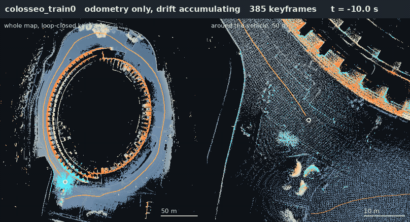

# SLIM LIO

Slim LIO is implemented in C++ using ROS2, Eigen, Sophus, nanoflann and GTSAM for real-time LiDAR-inertial SLAM. It consists of two nodes: `lio_node`, a tightly-coupled odometry front end built on an Iterated Extended Kalman Filter (IEKF) with point-to-plane LiDAR registration and IMU preintegration, and `slam_node`, a pose-graph back end that detects loop closures and keeps a globally consistent keyframe map.

It is a minimalistic yet effective implementation, designed to keep the codebase simple, readable, and focused while still providing robust LiDAR-inertial odometry performance.

The project focuses on efficient real-time odometry by combining:

* IMU-based motion propagation
* Point-to-plane scan matching
* Voxel-based local map representation
* Robust correspondence filtering
* Manifold-aware state optimization on SE(3)
* Keyframe pose graph with ICP-verified loop closures (iSAM2)

The implementation is designed to be modular, fast, and easy to understand for research and educational purposes.

## Build

```bash
cd ~/Workspace
colcon build --symlink-install --cmake-args -DCMAKE_BUILD_TYPE=Release
source install/setup.bash
```
## Play rosbag

The parameter file must match the bag's sensor: `config/colosseo.yaml` (default) subscribes to
`/ouster/points` and `/ouster/imu` (VBR, Ouster OS0), `config/mid360.yaml` to `/livox/mid360/lidar` and
`/livox/mid360/imu`. With the wrong file `lio_node` receives nothing and RViz stays empty.

```bash
ros2 bag play ~/ros2bags/Colosseo_train0/colosseo_train0_full          # VBR -> default config
ros2 bag play ~/ros2bags/Occlusion04_ros2/Occlusion04_ros2_0.db3       # Mid360 -> config:=mid360.yaml, see below
```

## Run slim_lio

Two launch files, one per use case. Both accept `config:=<params.yaml>` (default `config/colosseo.yaml`)
and `rviz:=false`.

```bash
# odometry only: lio_node + RViz (rviz/lio.rviz, fixed frame odom)
ros2 launch slim_lio lio.launch.py

# full SLAM: lio_node + slam_node + RViz (rviz/slim.rviz, fixed frame map, optimized path in orange)
ros2 launch slim_lio slam.launch.py

# other sensor: pass the matching parameter file
ros2 launch slim_lio slam.launch.py config:=$(ros2 pkg prefix slim_lio)/share/slim_lio/config/mid360.yaml
```

`slam.launch.py` includes `lio.launch.py`, so the odometry node is configured identically in both. The
evaluation scripts start the two binaries directly without RViz and call `save_map` at the end.

### lio_node (odometry front end)

Output convention (`publish_mid_scan_pose`, default `true`): `/slim_lio/Odometry`, `/slim_lio/pose`,
the `odom -> base_link` TF and `/slim_lio/downsampled_scan` carry the pose at the **middle of the scan**,
stamped with the scan **header** time — the convention of the VBR ground truth, KISS-ICP and PIN-SLAM.
Set it to `false` to publish the IEKF state at its own instant (last IMU sample at or before the scan end).

### slam_node (pose-graph back end)

`slam_node` has no parameters; the thresholds below are constants in `src/slam_node.cpp`.

* Subscribes to `/slim_lio/Odometry` and `/slim_lio/downsampled_scan`, joined with an exact-time
  synchronizer (both must carry the same stamp, which `lio_node` guarantees).
* Keeps a keyframe every 1.5 m or 15 deg of travel, storing the odometry pose and the body-frame scan.
* Searches loop candidates within 10 m of the optimized pose (excluding the last 30 keyframes) and verifies
  each with a multi-start ICP against a local submap; a match is rejected when a competing alignment basin is
  nearly as good, which prevents wrong-lane closures on parallel streets.
* Optimizes the graph incrementally with iSAM2 (odometry between-factors plus Cauchy-robust loop factors).
* Publishes `/slim_lio/optimized_path` and the `map -> odom` TF, so `map -> base_link` is the loop-closed pose.
  The TF is stamped 0.5 s into the future so RViz and navigation lookups at the latest scan stamp never fail.
* Service `/slam_node/save_map` (`std_srvs/Trigger`) writes `slim_lio_poses.tum` (optimized keyframe poses, TUM
  format) and `slim_lio_map.ply` (keyframe scans in the map frame, 0.2 m voxel downsampled) to the node's
  working directory. The call blocks until the loop-closure thread has processed every queued keyframe, so
  the saved trajectory always reaches the last keyframe even when playback outpaced loop verification:

```bash
ros2 service call /slam_node/save_map std_srvs/srv/Trigger
```

